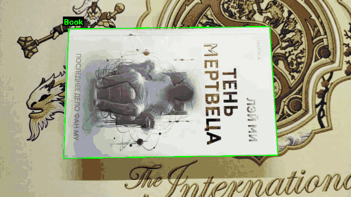
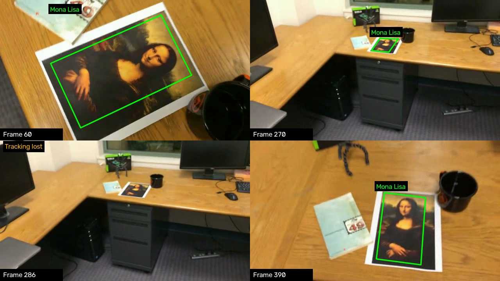
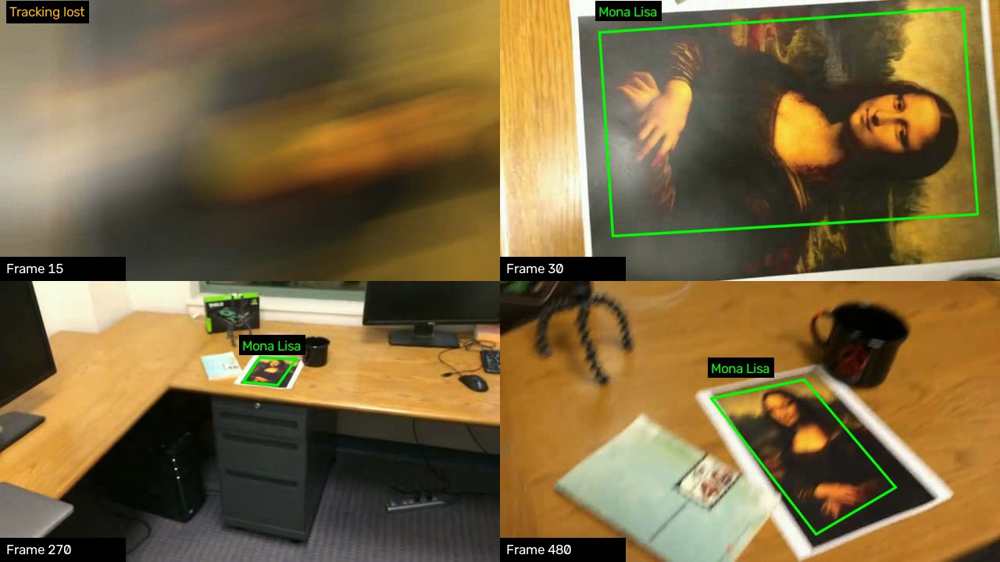
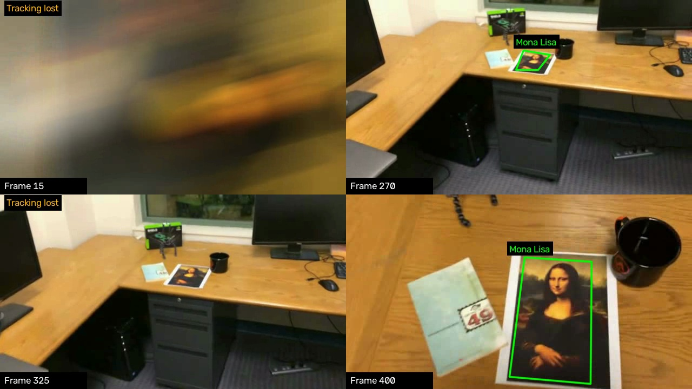
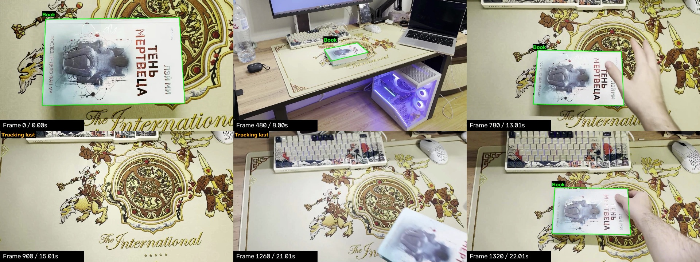

# Лабораторная работа 2

Трекинг плоского объекта по ключевым точкам.

Трофимов Владислав Дмитриевич, P3414, ИСУ 368925.

Результат на собственном видео с книгой. При удалении книги рамка исчезает, после возвращения поиск восстанавливается.



GIF показывает весь ролик в уменьшенном разрешении с частотой 6 кадров в секунду. В репозиторий включены код, отчёт, GIF и примеры кадров. Исходные и обработанные видео хранятся локально и доступны для демонстрации на защите.

## 1. Теоретическая база

SIFT находит характерные точки изображения и описывает окрестность каждой точки числовым вектором. Эти признаки позволяют сопоставлять объект при изменении масштаба и повороте.

Для каждого дескриптора ищутся два ближайших. Совпадение принимается, если расстояние до первого меньше 0,75 расстояния до второго. Так отбрасываются неоднозначные пары.

Гомография переводит координаты плоского объекта между двумя изображениями и учитывает перспективу. RANSAC оценивает её по согласованным совпадениям, отбрасывая выбросы. Границы эталона преобразуются этой матрицей в четырёхугольную рамку.

Дополнительно найденная область выпрямляется и сравнивается с первым изображением объекта. Нормированная корреляция яркости проверяет сходство рисунка и меньше зависит от общей яркости кадра. Это помогает отклонить геометрически правдоподобную рамку на постороннем фоне.

## 2. Описание разработанной системы

Вся программа находится в `main.py`. Используется один алгоритм на SIFT и гомографии.

1. Первый кадр, прямоугольная область `--roi` или четырёхугольник `--corners` становится исходным эталоном. Для четырёхугольника признаки фона исключаются маской.
2. На очередном кадре ищутся ключевые точки и совпадения с эталоном. Повторяющиеся координаты исключаются.
3. Для рамки нужны минимум 8 согласованных пар, доля согласованных пар от 50 процентов и их распределение хотя бы по 3 процентам площади эталона. Порог ошибки RANSAC равен 3 пикселям.
4. Проверяются конечность координат, выпуклость, площадь и пересечение рамки с кадром. Частичный выход объекта за границу допускается. Найденная область приводится к виду первого эталона и размеру 128 × 128. Её нормированная корреляция с исходным изображением должна быть не меньше 0,3. Участки вне кадра исключаются из сравнения.
5. Если исходный эталон не подошёл, тот же поиск выполняется по последнему подтверждённому виду объекта. Его признаки берутся внутри рамки с отступом от края и переводятся в координаты исходного эталона. Это помогает при постепенном изменении масштаба и перспективы. Проверка внешнего вида всегда использует первое изображение и выполняется до обновления признаков.
6. При успехе рисуются зелёная рамка и подпись. При отказе выводится `Tracking lost`, рамка отсутствует. Старые координаты не переносятся на новый кадр.

Первый кадр тестов содержит обрезанную репродукцию. Поэтому рамка следует границам видимого в нём фрагмента, а не внешнему краю белой бумаги. Если в первом кадре есть фон, нужно указать прямоугольник `--roi X Y W H` или четыре угла обложки `--corners`. Углы перечисляются по часовой стрелке, начиная с левого верхнего, в координатах кадра после учёта ориентации видео.

### Запуск в PyCharm

Открыть папку проекта, выбрать интерпретатор с OpenCV и NumPy, открыть `main.py`. В Parameters конфигурации запуска указать путь к локальному видео. В эту сокращённую копию видеоматериалы не включены, поэтому их нужно предоставить отдельно.

Зависимости устанавливаются командой `python -m pip install -r requirements.txt`. Проверка выполнена на Python 3.14.5, OpenCV 5.0.0 и NumPy 2.5.4. Окна программы не используются, достаточно пакета `opencv-python-headless`.

Примеры команд выполняются из папки проекта. Пути `/path/to/...` нужно заменить путями к своим локальным файлам.

```bash
python main.py /path/to/mona-lisa.avi --label "Mona Lisa"
python main.py /path/to/mona-lisa-blur.avi --label "Mona Lisa"
python main.py /path/to/mona-lisa-blur-extra-credit.avi --label "Mona Lisa"
python main.py /path/to/my-video.mp4 -o results/my-video_tracked.mp4 --label "Book"
python main.py /path/to/IMG_0250_silent.mp4 -o results/IMG_0250_tracked.mp4 --label Book --corners 375 158 1475 145 1520 850 348 868
```

Область эталона при наличии фона задаётся, например, аргументами `--roi 100 60 320 240`. Это пример координат, для своего кадра их нужно подобрать. Последняя команда использует четыре угла обложки в конкретной записи с книгой. В PyCharm все аргументы после `main.py` нужно вставить в Parameters. Подпись задаётся латиницей, автоматически увеличивается для Full HD и рисуется на тёмной подложке.

Без аргументов программа ожидает `test-videos/mona-lisa.avi` рядом с `main.py`. Такой запуск доступен в полной локальной папке `lab2`, где сохранены все видео. Для защиты можно открыть именно её в PyCharm. Код `main.py` в обеих папках одинаковый.

Выход записывается в MP4 с кодеком H.264 `avc1`, без звуковой дорожки. В установленной сборке OpenCV проверена его запись. Размер сохраняется, результат имеет постоянную частоту кадров с возможным небольшим округлением FPS кодеком. Ширина и высота должны быть чётными. Повторный запуск заменяет файл результата. Входной файл защищён от записи поверх него. Ошибочные пути и непригодный эталон дают сообщение об ошибке.

## 3. Результаты работы и тестирования системы

Повторно проверено 17.11.2026 после добавления проверки внешнего вида. Каждый стандартный ролик обработан полностью. Все выходы повторно декодированы, в каждом 558 кадров размером 640 × 360 с частотой 29,97 FPS, длительность около 18,62 секунды. `simple_track.avi` просмотрен как образец готового результата.

| Тест | Кадры с рамкой | Без рамки | Доля с рамкой |
| --- | --- | --- | --- |
| mona-lisa | 556 из 558 | 2 | 99,6 % |
| mona-lisa-blur | 537 из 558 | 21 | 96,2 % |
| mona-lisa-blur-extra-credit | 514 из 558 | 44 | 92,1 % |

Это доля кадров, прошедших проверки алгоритма, а не измеренная точность рамки. Ручной разметки тестов нет. Визуально просмотрены кадры с поворотом, изменением масштаба, перспективой, размытием и потерей. Часть видимых объектов алгоритм пропускает.

Обычный ролик, поворот, удаление камеры, потеря на кадре 286 и повторное обнаружение. Нумерация кадров начинается с нуля.



Ролик с размытием, отказ на кадре 15 и успешное продолжение после него.



Сложный вариант, отказ при сильном размытии, небольшой объект и восстановление.



Полные результаты сохранены в папке `results` локального проекта `lab2`. В эту сокращённую копию включены GIF и примеры кадров. Запуск без аргументов проверен в полном проекте, содержащем тестовый ролик, в том числе из другой рабочей папки.

Отдельные регрессионные проверки подтвердили поиск при известной перспективе, повороте на 63 градуса, уменьшении вдвое и частичной видимости. Максимальная ошибка углов в этих одиночных синтетических случаях меньше 0,86 пикселя. Пустой кадр и посторонняя текстура не дали рамки. Проверены потеря и возврат объекта, область эталона с фоном, ошибочные пути, вырожденные преобразования и ошибки чтения и записи.

Все 53 регрессионные проверки прошли. Они включают 29 прежних сценариев, 20 проверок четырёхугольной области и отображения, 4 проверки реального фрагмента удаления книги. В синтетической последовательности с изменением ракурса найдены 81 из 81 кадров с объектом, после неё 9 кадров с пустым фоном и посторонними текстурами не дали ложной рамки. При сильной перспективе ошибка угла достигала 15,46 пикселя, после возврата исходного ракурса снизилась до 0,045 пикселя.

### Собственная запись с книгой

17.11.2026 проверена собственная запись `IMG_0250.MOV`. Перед обработкой удалён звук. Подготовлена локальная копия `IMG_0250_silent.mp4` в H.264 размером около 18,6 МБ. Разрешение Full HD, длительность и все кадры сохранены. В копии и готовом результате подтверждено отсутствие аудиодорожек. Исходный файл в Downloads сохранён. В репозитории результат представлен GIF и примерами кадров, сами видео хранятся локально.

Длительность исходника около 24,362 секунды, размер 1920 × 1080, 1461 кадр, средняя частота около 59,971 FPS. Результат имеет ту же частоту с небольшим округлением и длится около 24,362 секунды. Итоговый файл полностью декодирован OpenCV и системным декодером macOS, число кадров и ориентация сохранены. Для эталона вручную заданы четыре угла обложки, чтобы исключить рисунок коврика. Приведённые ниже результаты получены повторным запуском на локальной сжатой копии.

| Участок | Кадры с рамкой | Наблюдение |
| --- | --- | --- |
| 0-809 | 810 из 810 | Крупный и дальний планы, возвращение камеры к книге |
| 810-856 | 21 из 47 | Быстрое удаление книги, смаз и частичная видимость |
| 857-1242 | 0 из 386 | Книга полностью отсутствует, ложных рамок нет |
| 1243-1281 | 0 из 39 | Размытый край книги появляется при возвращении |
| 1282-1460 | 179 из 179 | Обложка снова найдена, рамка сохраняется до конца |

Всего получено 1010 кадров с рамкой. Это число нельзя делить на длительность всего ролика для оценки качества поиска, поскольку книга намеренно отсутствует. При быстром удалении и сильном смазе рамка кратковременно неточна. С кадра 831 рисование прекращается, после возвращения восстанавливается на кадре 1282, примерно на 21,38 секунды.

Первый прогон выявил ложный захват коврика после удаления книги. Обновляемый эталон постепенно запоминал признаки фона. Проверка внешнего вида по первому изображению устранила продолжение этого дрейфа. В отдельной регрессии без этой проверки появлялись 74 ложные рамки на 74 кадрах пустого участка, с проверкой их стало 0.



## 4. Выводы по работе

Программа отслеживает текстурированный плоский объект с учётом поворота и перспективы и сохраняет размеченное видео. Использование последнего подтверждённого вида помогает при постепенном удалении камеры.

Сильное размытие, малое число деталей, перекрытие и резкие изменения ракурса вызывают пропуски. При обновлении эталона возможно накопление ошибки рамки. Поиск и проверка внешнего вида по первому кадру помогают возвращаться к исходным границам, но не гарантируют пиксельную точность и различение любых похожих рисунков. Значение `Tracking lost` означает недостаточно надёжное обнаружение, а не доказанное отсутствие объекта.

Собственная запись с книгой обработана и проверена. При обычном движении рамка соответствует обложке, на всём участке без книги рамки нет, после возвращения поиск восстанавливается. На сильном смазе остаются кратковременные неточности и пропуски, поэтому буквальное обнаружение на каждом кадре с видимым объектом не достигнуто.

Код и отчёт подготовлены локально. Требуемое заданием размещение на GitHub пока не выполнено.

## 5. Использованные источники

- [Оригинальное задание, страница 1](LW2_25.pdf). Требования к программе и пяти разделам отчёта.
- Тестовые материалы задания, три исходных ролика `mona-lisa.avi`, `mona-lisa-blur.avi`, `mona-lisa-blur-extra-credit.avi` и образец `simple_track.avi`. Хранятся локально в полном проекте.
- Собственная запись без звука `IMG_0250_silent.mp4`. Проверена 17.11.2026, исходник `IMG_0250.MOV` предоставлен автором работы. Хранится локально в полном проекте.
- [OpenCV, Introduction to SIFT](https://docs.opencv.org/4.13.0/da/df5/tutorial_py_sift_intro.html). Ключевые точки, дескрипторы и отбор совпадений.
- [OpenCV, Feature Matching + Homography to find Objects](https://docs.opencv.org/4.13.0/d1/de0/tutorial_py_feature_homography.html). Сопоставление точек, RANSAC и проекция границ объекта.

Задание и документация проверены 29.10.2026. Собственная запись и итоговые результаты проверены 17.11.2026.
